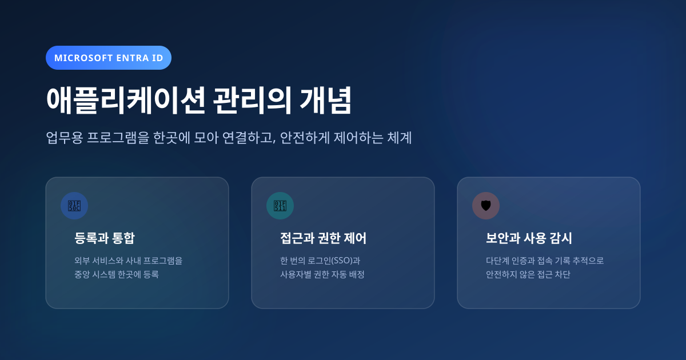
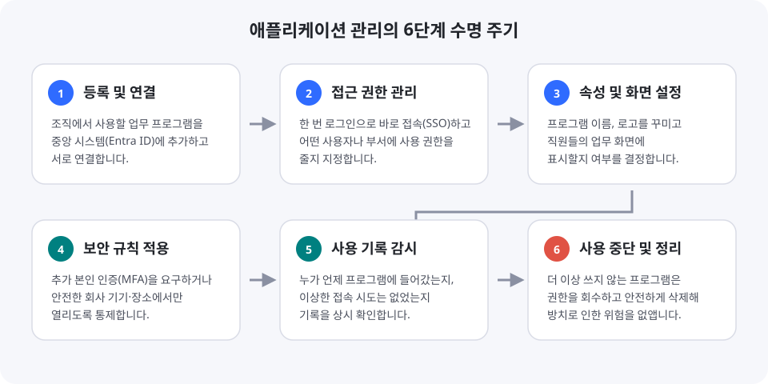
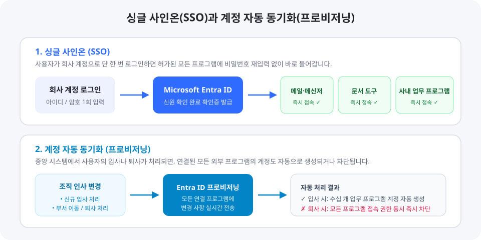
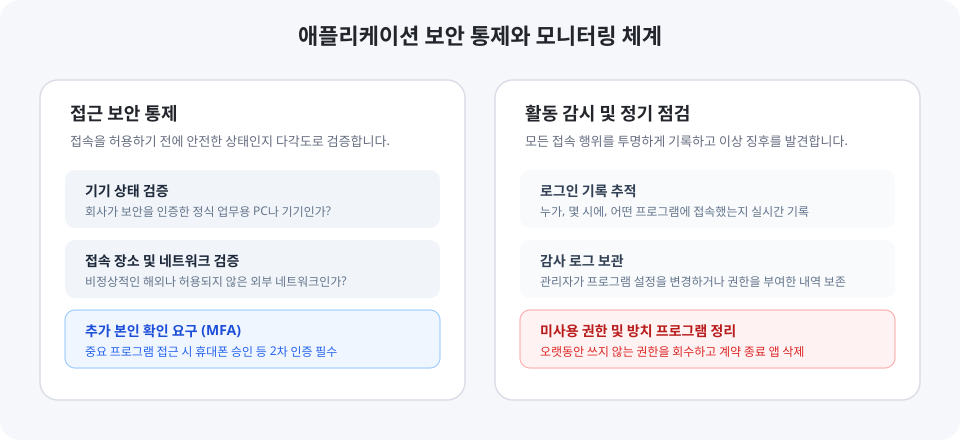

---
layout: post
title: "Microsoft Entra ID - 애플리케이션 관리"
permalink: /blog/azure/entraid/what-is-application-management
date: 2026-11-01 16:50:00 +0900
tags: [Azure, EntraID, 보안, 입문]
categories: [Azure, EntraID]
image: /assets/posts/azure/entraid/what-is-application-management-cover.svg
image_caption: ""
featured: false
video: false
description: "업무용 프로그램을 한곳에 모아 연결하고, 안전하게 로그인하며, 사용 권한을 제어하는 Entra ID 애플리케이션 관리의 원리를 정리했습니다."
---

> **한 줄 요약**  
> Microsoft Entra ID의 애플리케이션 관리는 **"조직에서 업무에 사용하는 수많은 프로그램을 하나의 중앙 시스템에 등록하여, 안전하게 로그인하고 사용 권한을 통제하며 관리하는 체계"**입니다.

---

## 1. 애플리케이션 관리란 무엇인가?

조직에서는 메일, 문서 작성, 협업 도구, 회계 시스템 등 수많은 프로그램을 매일 사용합니다.

과거에는 프로그램마다 각각 계정을 만들고, 비밀번호를 따로 설정하며, 관리자가 프로그램마다 일일이 들어가서 직원의 계정을 생성하고 권한을 부여해야 했습니다. 이 방식은 프로그램 수가 늘어날수록 관리가 매우 복잡해지고, 비밀번호 유출이나 퇴사자의 계정 방치 같은 보안 문제가 발생하기 쉽습니다.

Microsoft Entra ID의 **애플리케이션 관리(Application Management)**는 이러한 문제를 해결하기 위해 고안되었습니다.

조직에서 사용하는 모든 프로그램을 **Microsoft Entra ID라는 단 하나의 중앙 관제 센터에 등록**해 두고, 누가 어떤 프로그램에 접속할 수 있는지, 어떤 보안 검사를 거쳐야 하는지를 한자리에서 결정하고 통제합니다.

- **중앙 집중화** — 각 프로그램에 흩어져 있던 계정과 로그인 관리를 Entra ID 한곳으로 모읍니다.
- **보안 일원화** — 모든 프로그램에 동일하게 엄격한 보안 규칙을 한 번에 적용합니다.
- **편의성 향상** — 직원은 회사 계정 하나만 기억하면 허가된 모든 업무 프로그램에 손쉽게 들어갈 수 있습니다.

---

## 2. 애플리케이션 관리의 6단계 수명 주기

Microsoft Entra ID에서 프로그램을 관리하는 과정은 프로그램의 도입부터 폐기까지 총 6단계의 일정한 흐름을 따릅니다.

### 1단계: 등록 및 연결 (추가하기)
조직에서 사용할 프로그램을 Entra ID 시스템에 인식시키는 단계입니다.
- 마이크로소프트의 공식 목록(애플리케이션 갤러리)에 이미 등록되어 있는 외부 클라우드 서비스는 클릭 몇 번으로 쉽게 연결할 수 있습니다.
- 사내에서 자체 개발한 프로그램이나 회사 내부 전산실에 있는 프로그램도 통신 통로를 열어 Entra ID에 연결할 수 있습니다.

### 2단계: 접근 권한 관리 (사용자 배정)
등록된 프로그램을 조직 내의 누구에게 열어줄 것인지 결정하는 단계입니다.
- 특정 개인이나 부서(그룹) 단위로 프로그램 사용 권한을 부여합니다.
- 권한이 부여되지 않은 사람은 프로그램 접속 화면 자체에 접근할 수 없습니다.

### 3단계: 속성 및 화면 설정 (표시 방식 구성)
직원들이 프로그램을 사용할 때 보이는 화면과 기본 동작 방식을 설정하는 단계입니다.
- 프로그램의 공식 명칭과 로고를 지정합니다.
- 직원들이 회사 업무 프로그램을 한눈에 모아볼 수 있는 전용 포털(내 앱 포털)에 해당 프로그램 아이콘을 표시할지 여부를 결정합니다.
- 일시적인 점검이 필요할 경우 로그인 기능을 잠시 꺼둘 수도 있습니다.

### 4단계: 보안 규칙 적용 (접속 보호)
프로그램을 사용할 때 충족해야 하는 보안 수준을 정하는 단계입니다.
- 접속 시 휴대폰 인증 같은 추가 확인(다단계 인증)을 반드시 거치도록 설정합니다.
- 회사에서 승인한 업무용 기기나 안전한 네트워크에서만 접속되도록 제한을 둡니다.

### 5단계: 사용 기록 감시 (모니터링)
프로그램이 실제로 어떻게 사용되고 있는지 실시간으로 감독하는 단계입니다.
- 직원이 언제 어느 프로그램에 로그인했는지 기록이 남습니다.
- 관리자가 권한 설정을 변경한 내역도 투명하게 보관됩니다.

### 6단계: 사용 중단 및 정리 (삭제하기)
더 이상 사용하지 않는 프로그램의 연결을 해제하고 시스템에서 깨끗하게 지우는 단계입니다.
- 계약이 끝난 외부 서비스나 폐기된 사내 시스템은 권한을 모두 회수하고 등록을 삭제하여, 관리되지 않는 통로가 남아 보안 취약점이 되는 것을 원천 차단합니다.

---

## 3. 핵심 기능 — 싱글 사인온(SSO)과 계정 자동 동기화

애플리케이션 관리에서 가장 중요한 두 가지 핵심 기능은 **싱글 사인온**과 **사용자 프로비저닝**입니다.

### 싱글 사인온 (SSO, Single Sign-On)
**단 한 번의 로그인으로 조직의 모든 프로그램에 추가 암호 입력 없이 바로 접속하는 기술**입니다.

1. 직원이 회사 컴퓨터나 브라우저에서 Entra ID 계정으로 최초 1회 로그인을 완료합니다.
2. 메일, 문서 도구, 업무 시스템 등 다른 프로그램을 열 때마다 매번 아이디와 비밀번호를 다시 입력할 필요 없이, Entra ID가 발행한 인증 확인증을 통해 즉시 접속이 이루어집니다.
3. 각 프로그램마다 복잡한 비밀번호를 따로 외울 필요가 없으므로 비밀번호 분실이 줄어들고, 보안성이 크게 향상됩니다.

### 계정 자동 동기화 (사용자 프로비저닝)
**중앙 인사 정보의 변동 사항을 연결된 모든 프로그램에 자동으로 전송하여 계정을 생성, 수정, 삭제하는 기능**입니다.

- **신규 입사 시**: Entra ID에 직원의 새 계정을 생성하고 부서를 배정하면, 직원이 업무에 사용해야 할 수많은 개별 프로그램들 안에 직원의 계정이 자동으로 만들어집니다.
- **부서 이동 시**: 부서가 변경되면 새 부서에 필요한 프로그램 권한이 자동으로 부여되고, 이전 부서에서만 쓰던 프로그램의 권한은 자동으로 회수됩니다.
- **퇴사 시**: Entra ID에서 계정을 비활성화하는 즉시, 연결되어 있던 모든 외부 및 사내 프로그램의 계정이 일제히 잠기거나 삭제됩니다. 담당자가 개별 프로그램을 일일이 찾아다니며 삭제하지 않아도 접근이 완벽하게 차단됩니다.

---

## 4. 접속 보안과 조건부 통제

중앙 집중식 관리의 가장 큰 장점은 강력한 보안 규칙을 모든 프로그램에 빈틈없이 적용할 수 있다는 점입니다.

### 조건부 액세스 (Conditional Access)
정확한 아이디와 비밀번호를 입력했다고 해서 무조건 접속을 허용하지 않고, **접속 환경의 안전성을 실시간으로 확인한 뒤에만 프로그램 실행을 허락하는 지능형 통제 장치**입니다.

- **기기 확인** — 회사의 보안 기준을 통과한 인가된 기기인지 점검합니다.
- **네트워크 확인** — 정상적인 회사 내부망인지, 아니면 위험도가 높은 외부 공용 인터넷망인지 분석합니다.
- **위험도 평가** — 평소와 완전히 다른 이상 위치나 접속 패턴이 감지되면 즉시 접속을 차단하거나 추가 인증을 요구합니다.

### 다단계 인증 (MFA, Multi-Factor Authentication)
비밀번호 입력 후 스마트폰 알림 승인이나 인증 번호 입력 등 **추가적인 본인 확인 절차를 요구하는 보안 방식**입니다. 중요한 기밀 정보를 다루는 업무 프로그램일수록 다단계 인증을 필수로 지정하여 계정 탈취 피해를 방지합니다.

---

## 5. 활동 감시와 정기 점검

프로그램을 연결한 이후에도 시스템은 지속적으로 사용 현황을 투명하게 기록하고 감독합니다.

### 로그인 로그 (Sign-in Logs)
누가, 몇 시에, 어떤 기기를 통해, 어느 프로그램에 성공적으로 로그인했는지, 혹은 로그인을 실패했는지에 대한 상세한 기록을 남깁니다. 이를 통해 의심스러운 로그인 시도를 빠르게 포착할 수 있습니다.

### 감사 로그 (Audit Logs)
관리자가 어떤 프로그램의 설정을 변경했는지, 누구에게 새롭게 권한을 부여하거나 회수했는지 등 시스템 내부의 모든 변경 작업 이력을 보존합니다.

### 권한 검토와 환경 정리
시간이 지나면서 직원의 역할이 바뀌거나 프로젝트가 종료되면, 과거에 부여받았던 프로그램 권한이 불필요하게 남아있는 경우가 생깁니다. Entra ID는 정기적인 권한 검토 기능을 통해 더 이상 쓰지 않는 권한을 회수하고, 사용 기한이 지난 프로그램 등록을 완전히 삭제하도록 유도하여 조직의 시스템을 항상 안전하고 깨끗한 상태로 유지합니다.

---

## 6. 핵심 요약

| 구분 | 주요 내용 |
| :--- | :--- |
| **개념** | 조직에서 사용하는 다양한 업무용 소프트웨어를 중앙 시스템(Entra ID) 한곳에 모아 등록하고 제어하는 체계 |
| **도입 효과** | 계정 관리의 일원화, 보안 정책의 통일된 적용, 사용자 로그인 편의성 증대 |
| **수명 주기** | ① 등록 및 연결 &rarr; ② 접근 권한 관리 &rarr; ③ 속성 구성 &rarr; ④ 보안 규칙 적용 &rarr; ⑤ 기록 감시 &rarr; ⑥ 사용 중단 및 정리 |
| **핵심 기술** | **싱글 사인온(SSO)** (단 한 번의 로그인) & **프로비저닝** (입·퇴사 시 계정 자동 생성 및 삭제) |
| **보안 강화** | **조건부 액세스** (안전한 기기·환경에서만 접속 허용) & **다단계 인증(MFA)** |

